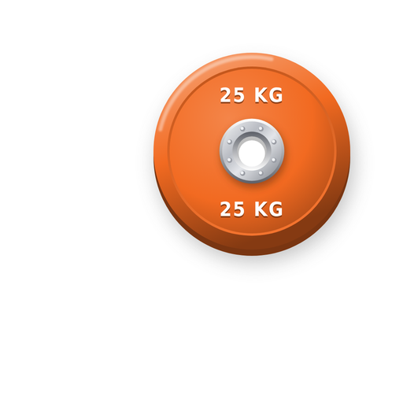

# Gym Log

Trainingskalender für einen Push/Pull/Beine-Split plus Ganzkörper-Training, gebaut als Web-App fürs iPhone.



## Funktionen

- **Monatskalender** im Stil von Apple Fitness: Trainingstage sind orange markiert, ein Farbpunkt zeigt die Trainingsart.
- **Vier Trainingsarten:** Brust & Trizeps, Rücken & Bizeps, Beine, Ganzkörper.
- **Übungskatalog** mit 61 Übungen (inklusive Maschinen- und Kabelübungen), jeweils mit Bild und Filter nach Muskelgruppe.
- **Eigene Übungslisten** pro Trainingsart. Am Trainingstag sind die Übungen frei wählbar und sortierbar.
- **Letztes Mal:** Bei jeder Übung siehst du Gewicht und Wiederholungen vom letzten Training. „Wie letztes Mal“ übernimmt sie mit einem Tipp.
- **Notizen pro Übung,** z. B. Sitzeinstellung an der Maschine.
- **Vorschlag fürs nächste Training:** Nie zweimal hintereinander die gleiche Trainingsart, höchstens einmal Beine pro Woche. Ganzkörper läuft in der Rotation mit.
- **Statistiken:** Trainings pro Woche (Ziel 5), Monatsübersicht und Kraftentwicklung je Übung.
- **Backup** als Datei oder Text, zum Sichern und Übertragen.
- **Offline nutzbar** und installierbar auf dem Home-Bildschirm.

## Auf GitHub veröffentlichen

1. Auf [github.com/new](https://github.com/new) ein neues Repository anlegen, z. B. `gym-log`. Öffentlich (Public) ist für kostenloses GitHub Pages nötig.
2. Im neuen Repository auf **„uploading an existing file“** klicken und **alle Dateien dieses Ordners** hochladen. Es gibt keine Unterordner, alles liegt auf einer Ebene. Dann **Commit changes**.
   Danach müssen im Repository direkt (nicht in einem Unterordner) u. a. `index.html` und `apple-touch-icon.png` liegen.
   > Die Datei `.nojekyll` ist auf dem Mac versteckt. Im Finder blendest du sie mit **Cmd + Shift + .** ein. Fehlt sie, funktioniert die App trotzdem.
3. **Settings → Pages:** Unter „Build and deployment“ als Source **Deploy from a branch** wählen, dann Branch **main** und Ordner **/ (root)**, und **Save**.
4. Nach ca. 1 Minute ist die App erreichbar unter
   `https://DEIN-GITHUB-NAME.github.io/gym-log/`

Alternativ per Terminal:

```bash
cd gymlog
git init && git add -A && git commit -m "Gym Log"
git branch -M main
git remote add origin https://github.com/DEIN-GITHUB-NAME/gym-log.git
git push -u origin main
```

## Auf dem iPhone installieren

1. Die GitHub-Pages-Adresse in **Safari** öffnen.
2. **Teilen** (Quadrat mit Pfeil) → **Zum Home-Bildschirm** → **Hinzufügen**.
3. Die App startet danach ohne Browserleiste wie eine normale App und funktioniert auch offline.

## Wo liegen meine Daten?

Alle Daten bleiben **nur auf deinem Gerät** (im lokalen Speicher der App) und werden nirgends hochgeladen. Das Repository enthält nur den Code und keine Trainingsdaten.

Wichtig:
- Die App auf dem Home-Bildschirm und dieselbe Seite im Safari-Tab haben **getrennte Speicher**. Nutze immer die App vom Home-Bildschirm.
- Löschst du die App vom Home-Bildschirm, sind die Daten weg. Mach deshalb ab und zu **Backup → Exportieren** und speichere die Datei in „Dateien“ oder iCloud Drive.

### Daten aus der Claude-Version übernehmen

1. In der Claude-Version unten bei **Backup** auf **Exportieren** tippen. Das Backup wird in die Zwischenablage kopiert.
2. In der installierten App bei **Backup** auf **Text einfügen** tippen, einfügen und **Importieren** wählen.

Beim Import werden vorhandene Daten nicht gelöscht, sondern zusammengeführt.

## Das Icon erscheint nicht?

- Prüfe, dass `apple-touch-icon.png` im Repository **auf oberster Ebene** liegt. Öffne zum Test `https://DEIN-GITHUB-NAME.github.io/gym-log/apple-touch-icon.png`: Dort muss das Bild erscheinen.
- iOS merkt sich das Icon beim Hinzufügen. Nach einer Änderung die App vom Home-Bildschirm **löschen**, Safari kurz schließen und die Seite **neu hinzufügen**.

## Updates

Änderungen an `index.html` hochladen und in `sw.js` die Zeile `const VERSION = "gymlog-v3"` hochzählen (z. B. auf `v4`). Die App holt sich die neue Version beim nächsten Start.

## Projektstruktur

```
index.html              App (HTML, CSS und JavaScript in einer Datei)
manifest.webmanifest    App-Name, Farben, Icons für „Zum Home-Bildschirm“
sw.js                   Service Worker für Offline-Nutzung
apple-touch-icon.png    App-Icon fürs iPhone (180 × 180)
icon-192.png, icon-512.png, maskable-*.png, favicon-32.png   Icons für Android und Browser
.nojekyll               sorgt dafür, dass GitHub Pages die Dateien unverändert ausliefert
```
